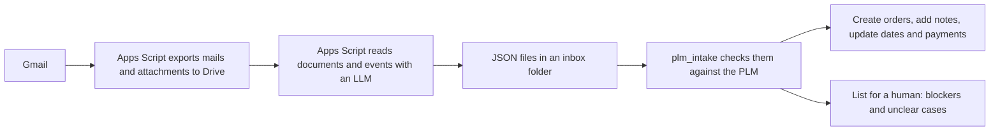

# PLM Intake Automation

A set of Python scripts and Google Apps Scripts that read supplier emails and purchase order files and enter the orders into our PLM (product lifecycle management) system. Built for the purchasing and production team, who kept the PLM up to date by hand.

## Why

Purchase orders, proforma invoices, packing lists and shipping news arrive as emails with Excel and PDF attachments, from many suppliers, in many layouts. Someone had to read each one, check that the vendor and products exist, type in the quantities per size, and later add changes like new dates, payments or shipments. It is repetitive and a typo in a quantity is easy to make and hard to find.

The tool does the reading and the checking and writes only when the result is clear. Everything unclear goes on a list for a person.

## How it works



1. `apps_script/mail_export.gs` runs hourly. It finds relevant business mails in Gmail (by attachment type, keywords and supplier domains) and saves the mails and attachments to Drive. It only reads Gmail.
2. `apps_script/extract_po.gs` sends new mails to an LLM (Gemini by default, Claude is a setting). It returns structured JSON, either a document with line items (PO, PI, invoice, packing list) or events (schedule changes, payments, shipments, samples, delays). The email text is treated as untrusted data, bank details are removed before saving, and there is a monthly cost limit.
3. `plm_intake/core.py` takes one extracted PO plus the current PLM state (vendors, products, orders) and decides `CREATE`, `UPDATE`, `SKIP` or `BLOCK`, with a list of issues. It is a pure function without network access, which makes it easy to test.
4. `plm_intake/auto_run.py` is the daily run. It reads the PLM through its REST API, plans everything, and in `--apply` mode creates the orders, attaches documents to existing orders and appends events as notes. The writes go through a headless browser script (`plm_intake/browser/run_in_plm.js`, Playwright) in the logged in PLM. A ledger remembers which inbox files are done, so a rerun never does the same thing twice.
5. `plm_intake/verify.py` reads everything back and checks that each new order exists exactly once and matches its source.
6. The run writes a short report and a status file. A health check stops the run early if the PLM is unreachable or the login has expired, and a watchdog in Apps Script warns when no successful run has happened in time.

Safety rules the code follows: it never deletes orders, never changes quantities, prices or payments of existing orders on its own, and stops instead of retrying blindly when a result is uncertain. The default mode is a dry run that only plans and reports.

## What else is in here

* `plm_intake/klaerfaelle.py` and `zuordnung.py`: a table in the PLM for unclear cases. A person writes the right order into a column and the next run uses that answer.
* `status_rules.py`: suggests order status changes, only when there is proof (a shipment, a paid instalment, an invoice with a packing list), and never downwards.
* `events.py`, `techpack_daily.py`, `shipments.py`, `payments_plan.py`: events as notes, techpack files attached to products, shipments and payment plans.
* Older standalone scripts in the repo root (`extract_po_excel.py`, `extract_po_legacy.py`, `review_po.py`, `plm_create_orders.py`, `plenty_*.py`, `plm_dima_*.py`) from the first version. They read PO Excel files directly without an LLM, and compare against the PLM and the shop's product data.

## Stack

Python 3 (`requests`, `python-dotenv`, `google-auth`, `pymupdf`, `openpyxl`), Node with Playwright for the browser steps, Google Apps Script (Gmail, Drive, Sheets), the Gemini and Claude APIs for extraction, the PLM REST API, GitHub Actions for the cloud run and launchd for the local schedule on macOS.

## Run it

```bash
python3 -m venv .venv && source .venv/bin/activate
pip install -r requirements.txt
cd plm_intake/browser && npm install && cd ../..
cp /dev/null .env     # then fill in the variables below

python3 -m plm_intake.auto_run            # dry run, writes nothing to the PLM
python3 -m plm_intake.auto_run --apply    # really creates orders and notes
python3 -m plm_intake.verify              # read back and check
python3 -m unittest discover -s plm_intake/tests
```

First login for the browser steps: `node plm_intake/browser/run_in_plm.js <script> --login`, which opens a window once and keeps the profile.

Environment variables, names only:

| Variable | Purpose |
|---|---|
| `LIFECYCLE_API_KEY` | PLM REST API key |
| `PLM_EMAIL`, `PLM_PASSWORD` | PLM login for the headless browser in the cloud run |
| `PLM_MODE` | `dry` (default) or `apply` |
| `PLM_INBOX_MODE` | `local` (default) or `drive_api` |
| `GOOGLE_SA_JSON` | Service account key content for reading the Drive inbox in the cloud |
| `PLM_DRIVE_ROOT_ID`, `PLM_DRIVE_INBOX_NAME` | Optional, which Drive folders to read |

Apps Script properties, names only: `GEMINI_API_KEY` or `ANTHROPIC_API_KEY` (depending on the provider), `GITHUB_TOKEN` (for the cloud watchdog), `SLACK_BOT_TOKEN` (for the kitchen duty script). The setup steps for each script are in the comment block at the top and bottom of its `.gs` file, including the trigger installers.

Scheduling: `plm_intake/launchd/install.sh` sets up weekday runs on a Mac. `plm_intake/cloud_run.sh` is the same run for GitHub Actions. In the cloud the run state lives in the `einpflege-zustand` branch. The branch `cloud-einpflege` is the version used for the cloud setup.

## Notes

* Reading the PO and the events with an LLM is the easy part. Most of the work went into the checks around it: sums that must match, duplicate detection, vendor name matching and a ledger so nothing is processed twice.
* The PLM API behaves differently from list to list (paging, error codes that still save). I wrote down each surprise in comments next to the code that deals with it.
* A dry run by default and a human list for unclear cases made it safe to let this run daily.

Built at Smilodox and published with permission. Supplier names, emails and business data were removed or replaced with placeholders.
